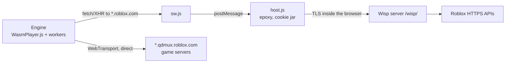

# webblox-built

Roblox's official browser client (binary type `WebClientApp`, an Emscripten
build) running on your own server, already built. Drop it into your site or
run it as-is.

Roblox's engine files are **not** in this repo. `bun run fetch:webblox` pulls
them straight from Roblox's CDN.

> Prefer having your agent build it from scratch? See
> [x8rr/webblox](https://github.com/x8rr/webblox).

## Quick start

Needs [Bun](https://bun.sh) and Node 18+ (for the fetch script).

```sh
bun install
bun run fetch:webblox   # ~255 MB into vendor/webblox/engine/
bun run build:proxy
bun start               # http://127.0.0.1:8080/blox/
```

`PORT` and `HOST` change where it listens. The page must be served over HTTPS
(or from `localhost`) for service workers and `SharedArrayBuffer`.

## Online login with Roblox

The home page opens Roblox through Scramjet 2. Choose **Other sign-in options
→ Email a code**, then open Webblox from the same site. Webblox
reads the Scramjet session from that browser automatically, so there is no need
to copy the `.ROBLOSECURITY` cookie. The normal Roblox login and any verification
steps still apply.

Both pages must be on the same HTTPS origin. The standalone Scramjet runtime is
included under `proxy/`; its Wisp connection is limited to Roblox, its CDN,
Roblox Labs, and login verification hosts. This keeps the server from becoming
a general purpose open proxy.

## Deploy on Render

The included `render.yaml` and `Dockerfile` define a public Render web service
on the free plan. Fork this repository to your GitHub account, connect that
fork in Render, and create a Blueprint from `render.yaml`. Render supplies an
HTTPS `onrender.com` URL and the port automatically. The Docker build downloads
the Roblox engine and builds the Scramjet launch integration.

The free service may sleep after 15 minutes without inbound traffic and can
restart at any time. Render also applies monthly instance-hour and bandwidth
limits; the service is intended for personal use and testing on the free plan.

Scramjet is licensed under AGPL-3.0. The vendored browser files and license are
in `proxy/` and `licenses/AGPL-3.0-Scramjet.txt`. Scramjet attribution and its
source links are shown on the home page.

Open `/blox/` for a small launcher (search, or paste a game link), or go
straight to a game with `/blox/?placeId=<id>` (`&gameInstanceId=<job id>` for
one server of it). Joining needs a signed-in Roblox session; see
[Signing in](#signing-in).

## How it works



- `/blox/` is served **cross-origin isolated** (COOP `same-origin` + COEP
  `require-corp`): the engine runs on pthreads over a shared
  `WebAssembly.Memory`. It must be a top-level page in its own tab or window,
  never an iframe inside a page without COEP.
- Every HTTP request the engine makes to Roblox (from the page or its
  workers) is caught by `sw.js` and handed to the page. `host.js` sends it
  over Wisp with [epoxy](https://github.com/MercuryWorkshop/epoxy-transport),
  which terminates TLS in the browser, so the Wisp server never sees the
  session. Cookies live in a jar in `localStorage`.
- Game traffic is WebTransport straight to `*.qdmux.roblox.com`, not through
  Wisp.
- Join quirks handled in `host.js`: `gamejoin` is called with
  `rbx-user-agent: Roblox/Darwin` and the `*.qdmux.roblox.com` name is derived
  from the join response when Roblox leaves `gameFqdn` out; other requests get
  a native client user agent; `?gameInstanceId=` turns `/v1/join-game` into
  `/v1/join-game-instance`.
- The engine's feature flags are pinned next to it
  (`engine/PinnedFlags.json`, written by the fetch script) so a later Roblox
  flag push cannot break an older engine.

## Files

| Path | Role |
|---|---|
| `webblox/index.html`, `host.css` | Host page. Every DOM id in it is looked up by `WasmPlayer.js`; keep them. |
| `webblox/host.js` | Relay (sw → epoxy → Wisp), cookie jar, session, launcher, engine boot. |
| `webblox/sw.js` | Service worker scoped to `/blox/` that hands cross-origin requests to the page. |
| `server/blox.ts` | `createBloxHandler(paths)`: serves `/blox/*` with the isolation headers, sends the gzip copy of `WebClient.wasm`, falls back to Roblox's CDN for engine files missing on disk. |
| `server.ts` | Standalone server: `/blox/` plus a Wisp server at `/wisp/` limited to Roblox hosts on port 443. |
| `scripts/fetch-webblox.mjs` | Downloads the engine from `setup.rbxcdn.com` (resumable, size-checked). |
| `integrations/scramjet/` | Optional: a Scramjet 2 frame plugin that turns Play on roblox.com into `/blox/`. |

## Engine

```sh
bun run fetch:webblox                            # current production version
bun run fetch:webblox version-f807b21caba84809   # a specific upload
```

It resolves the version from
`clientsettings.roblox.com/v2/client-version/WebClientApp`, downloads
`WasmPlayer.js`, `WebClient.js`, `WebClient.wasm` (~100 MB),
`WebClient.metadata.json`, `audio-processor-fast.js` and the ~2900 content
files the metadata lists, gzips `WebClient.wasm`, and pins the live flags.
Files already on disk with the right size are skipped, so an interrupted run
resumes. A new version replaces the old one. Rerun it to update.

## Embedding in your own server

1. Copy `webblox/`, `server/blox.ts` and `scripts/fetch-webblox.mjs`, and add
   `@mercuryworkshop/epoxy-transport` (3.x) as a dependency.
2. Mount the handler (Bun):

   ```ts
   import { BLOX_PREFIX, createBloxHandler } from "./server/blox";

   const handleBlox = createBloxHandler({
     host: "webblox",
     engine: "vendor/webblox/engine",
     epoxy: Bun.resolveSync("@mercuryworkshop/epoxy-transport", import.meta.dir),
   });

   // in your fetch handler
   if (pathname.startsWith(BLOX_PREFIX)) return handleBlox(req, pathname);
   ```

   Not on Bun? The handler is ~130 lines of Request/Response; swap `Bun.file`
   for your runtime's file API. Whatever serves it must keep the
   COOP/COEP/CORP headers.
3. Give the page a Wisp server. It uses `/wisp/` on its own host unless
   opened with `?wisp=wss://…`, which it then remembers. If you run your own,
   restrict it to Roblox like `server.ts` does, or it is an open proxy.
   Roblox rate-limits per IP, and the IP it sees is the Wisp server's.
4. Open `/blox/?placeId=…` in a new tab or popup, never an iframe.

## Scramjet integration

`integrations/scramjet/plugin.ts` is a Scramjet 2 frame plugin. Inside the
proxy it catches every way roblox.com launches the desktop app
(`roblox-player:` / `roblox://` URIs set as a hidden iframe `src`, passed to
`window.open` or used as a link, and `/games/start?placeId=` by link,
`window.open` or navigation) and opens `/blox/` on that place instead. "Join"
on a friend looks up their presence to find the server.

```ts
import { bloxUrl, createBloxLaunchPlugin } from "./integrations/scramjet/plugin";

// next to your other Scramjet controller plugins
createBloxLaunchPlugin(plugins.ManagedPlugin, {
  url: (launch) => bloxUrl("/blox/", launch, "wss://your.host/wisp/"),
  // optional: open(url) => Window | null, notify(message) => void
});
```

When `/blox/` shares an origin with the Scramjet 2 controller, `host.js` reads
the Roblox session from the controller's browser storage, so signing in to
roblox.com in the proxy signs in the player too. No cookie copying is needed.

## Signing in

Joining needs an authenticated Roblox session (without one Roblox answers 524
"Not authorized"):

- **Through the Scramjet 2 proxy on the same origin:** open the home page and
  choose "Other sign-in options" → "Email a code". If you get a CAPTCHA, use
  audio mode; for 2FA, choose "More options" → "Email". Then open `/blox/`;
  it picks up the session automatically.

Using a modified client carries a small risk of an account warning from
Roblox. Proceed with caution.

## Tests

```sh
bun test
bun run typecheck
```

## Credits

- Roblox's `WebClientApp` engine belongs to Roblox and is downloaded from
  their CDN, not distributed here.
- [epoxy-transport](https://github.com/MercuryWorkshop/epoxy-transport) and
  [wisp-js](https://github.com/MercuryWorkshop/wisp-js) by MercuryWorkshop.
